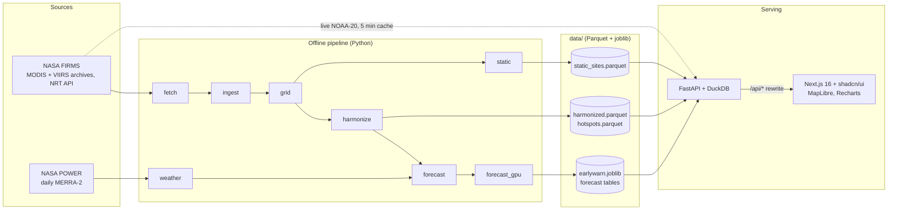

# FireRosetta

**One fire record from two satellites: MODIS and VIIRS hotspots harmonized onto a single scale, from 2000 to today.**

FireRosetta is Team MostrAI's project for the NASA Space Apps 2026 challenge
**"Harmonization of MODIS and VIIRS Hot Spots"**.

MODIS sees the ground in 1 km pixels, VIIRS in 375 m pixels. The same fire front is a handful of
MODIS hotspots and several times as many VIIRS hotspots, so putting the two records end to end
makes fire activity appear to triple in 2012. It did not. FireRosetta learns, from the years both
sensors flew together, what VIIRS would have counted given what MODIS reported, and applies that
to the MODIS-only years. Every figure before 2012 is an estimate on the VIIRS scale, and it
carries an uncertainty range.

## What you can do with it

- **Burning calendar** (`/`): pick an area (draw a polygon, choose a country or preset region, or
  type a lat/lon box) and get a monthly hotspot calendar from 2000 to today, anomalies against the
  median, year-by-year comparison, and the raw hotspots on a map. Series export as CSV, charts and
  the calendar as PNG.
- **Early Warning** (`/risk`): two layers on one map that answer two different questions and are
  deliberately never mixed into one score:
  - *Now*: where has it been burning in the last days? Live NOAA-20 detections plus the history
    of the same calendar month, on an adaptive 20 → 10 → 5 km grid.
  - *Outlook*: where could the next 1–3 months be unusually active? A supervised model on fire
    history and antecedent weather, per 1° block.
- **How it works** (`/method`): the harmonization method and its validation, computed live from
  the same metrics the pipeline wrote.
- **Persistent heat sources**: an unsupervised detector flags chimneys, gas flares and steel mills
  that slipped through FIRMS's own labelling, so they are drawn as "not a fire" instead of being
  read as burning.

## Quick start

### Prerequisites

| Tool | Version | Notes |
|---|---|---|
| [uv](https://docs.astral.sh/uv/) | any recent | manages Python (≥ 3.11) and the backend dependencies |
| Node.js + npm | Node 20+ | for the Next.js frontend |
| `libomp` | macOS only | XGBoost needs OpenMP; `start.sh` installs it with Homebrew if missing |
| [GitHub CLI](https://cli.github.com/) (`gh`) | optional | used to download the prebuilt data bundles; required while the repository is private, otherwise `curl` is used |

### macOS / Linux

```bash
git clone https://github.com/yusarican/firerosetta.git
cd firerosetta
./start.sh
```

Then open <http://localhost:3000>. `Ctrl+C` stops both the API and the web app.

On first run `start.sh` installs the dependencies and downloads the prebuilt data and model
bundles from GitHub Releases (about 280 MB in total, sha256-verified), so a fresh clone does not
have to pull the FIRMS archive and retrain everything. If the download fails (no network, no
access), it falls back to running the full pipeline itself.

| Command | What it does |
|---|---|
| `./start.sh` | Download whatever is missing, then start API + web |
| `./start.sh --rebuild` | Re-download from FIRMS (~730 MB) and retrain all three models |
| `./start.sh --with-forecast` | Also train the early-warning model locally (NASA POWER, ~9 min) |
| `./start.sh --with-static` | Also train the static-heat-source detector locally (~1 min) |

Ports can be changed with `API_PORT` and `WEB_PORT` (defaults 8000 and 3000).

### Windows

```powershell
powershell -ExecutionPolicy Bypass -File .\start.ps1
```

The launcher prepares missing data, starts the API and the web app, and opens the browser. It
uses the tools bundled under `.runtime\` if present, otherwise an installed `uv`, Node.js and npm.
Options: `-Rebuild`, `-NoBrowser`, `-ApiPort`, `-WebPort`. Logs go to `.logs\`. Unlike `start.sh`,
it builds the data with the pipeline rather than downloading the release bundles, so the first run
takes longer; to use the bundles, extract them into `data\` first (see below).

### Configuration

| Variable | Where | Purpose |
|---|---|---|
| `FIRMS_MAP_KEY` | `.env` in the repo root, or environment | Free [FIRMS MAP_KEY](https://firms.modaps.eosdis.nasa.gov/api/map_key/). Optional: needed only for the current year and for live detections on the Early Warning page. Copy `.env.example` to `.env`. |
| `FIREROSETTA_DATA` | environment | Data directory (default `./data`) |
| `FIREROSETTA_API_URL` | environment (web) | Where Next.js proxies `/api/*` (default `http://127.0.0.1:8000`) |
| `FIREROSETTA_DEVICE` | environment | Force `cpu` or `cuda` for training |
| `FIREROSETTA_REPO` | environment | GitHub repo the release bundles come from |

Without a MAP_KEY everything still works on the published archive; the Early Warning page falls
back to local data and says so.

## Manual installation

The same steps `start.sh` runs, one by one.

```bash
# 1) Backend dependencies
cd backend
uv sync

# 2a) Either download the prebuilt bundles ...
../scripts/release.sh fetch              # all three; or: fetch data | earlywarn | static

# 2b) ... or build everything from source (~10 min, downloads ~730 MB)
uv run python -m firerosetta.fetch       # FIRMS country archives (no key needed)
uv run python -m firerosetta.ingest      # one schema -> data/staged/hotspots.parquet
uv run python -m firerosetta.grid        # quality screen + 0.1° cell x month table
uv run python -m firerosetta.harmonize   # MODIS->VIIRS model, cross-validation, harmonized.parquet

# optional: early-warning model (~6 min, plus ~12 min on a CUDA GPU for the second member)
uv run python -m firerosetta.weather     # NASA POWER daily -> monthly fire-weather indices
uv run python -m firerosetta.forecast    # 1-3 month outlook, walk-forward validation
uv run --extra gpu python -m firerosetta.forecast_gpu   # XGBoost/CUDA member + blend

# optional: static-heat-source detector (~1 min, CPU)
uv run python -m firerosetta.static

# 3) API
uv run uvicorn firerosetta.api:app --port 8000

# 4) Web (second terminal)
cd ../web
npm install
npm run dev                              # http://localhost:3000
```

The site degrades gracefully: without the early-warning model the Outlook layer switches off,
without the detector `/static-sources` returns 503, and everything else keeps working.

### Prebuilt bundles

One bundle per trained model, so you only download what you need:

| Bundle | Release tag | Contents | Size |
|---|---|---|---|
| `data` | `data-v1` | Harmonized table, its metrics, and the hotspot table it was built from | ~225 MB |
| `earlywarn` | `earlywarn-v1` | Blended 1–3 month early-warning model + inference and backtest tables | ~41 MB |
| `static` | `static-v1` | Static-heat-source detector + the scored site table | ~14 MB |

```bash
./scripts/release.sh fetch            # download, verify sha256, extract into data/
./scripts/release.sh fetch static     # just one
./scripts/release.sh list             # what is published right now
```

Every bundle stores its files under the `data/` subdirectory they belong in, so all three extract
the same way (`tar -xzf <bundle> -C data`). `fetch` refuses to extract on a checksum mismatch.

### Tests

```bash
cd backend && uv run python -m unittest discover -s tests -v
cd web && npm test && npm run lint
```

## Architecture



**Offline pipeline.** Plain Python modules, each runnable as `python -m firerosetta.<step>`, each
reading and writing Parquet. `fetch` records the URL, SHA-256, size and time of every downloaded
file in `data/manifest.json`, so the provenance of each number is traceable.

**API.** FastAPI over DuckDB, which queries the Parquet files in place; there is no database
server to run. Area queries (country or any GeoJSON polygon) are resolved against the 0.1° grid,
and validation error and intervals are computed *for the area the user drew*, not quoted from a
global table. The only live call is the Early Warning page's NOAA-20 feed, cached for 5 minutes.

**Web.** Next.js 16 (App Router) with shadcn/ui, Tailwind CSS 4, MapLibre GL and Recharts. The
browser only ever talks to the Next.js origin: `/api/*` is rewritten to the Python API, which
stays private.

### Project structure

```
backend/firerosetta/
  config.py        Countries, sensors, paths
  fetch.py         FIRMS yearly country CSVs + current year -> data/raw, manifest.json
  ingest.py        Closes MODIS/VIIRS schema differences -> data/staged/hotspots.parquet
  grid.py          Quality screen + dense 0.1° x month table (zeros included)
  harmonize.py     MODIS->VIIRS model, 5-fold CV blocked by year, metrics.json
  weather.py       NASA POWER daily (MERRA-2) -> 1° block x month fire-weather indices
  forecast.py      Early-warning model: 1-3 months ahead, walk-forward validation, packaging
  forecast_gpu.py  XGBoost/CUDA second member + blend; refuses to install if it does not win
  model.py         Training-time regression head (deliberately not what gets pickled)
  static.py        Unsupervised static-heat-source detector -> static_sites.parquet
  gpu.py           Single device selection for every training step
  risk.py          Observed-activity priority grid for the Early Warning page
  api.py           FastAPI + DuckDB
backend/tests/     unittest suite for the risk layer
scripts/release.sh Build / publish / fetch the three bundles (sha256-verified)
web/src/app/       Routes: / (calendar), /risk (early warning), /method
web/src/components/fire/   Workbench, maps, calendar, charts, forecast, risk dashboard
web/src/components/ui/     shadcn/ui components
web/src/lib/       API client, exports, colour scales, outlook and risk helpers
data/              (git-ignored except manifest.json) raw / staged / processed / models
start.sh, start.ps1  One-command launchers
```

### API

All routes are served by the backend at `:8000` and reachable from the browser under `/api`.
Area bodies are `{"country": "Turkey"}` or `{"geometry": <GeoJSON Polygon>}`.

| Route | Method | Returns |
|---|---|---|
| `/meta` | GET | Countries, date coverage, data freshness, which optional models are installed |
| `/calendar` | POST | Monthly harmonized series, climatology, yearly totals, local skill and intervals |
| `/hotspots`, `/hotspots.csv` | POST | Individual detections in a date range, with a `static_source` flag |
| `/validation` | GET | Cross-validation metrics of the harmonization |
| `/risk` | GET, POST | Observed-activity priority grid for a country or polygon (5 / 10 / 20 km) |
| `/risk/grid-count` | POST | Number of grid cells in the current map view |
| `/forecast` | POST | 1–3 month outlook and its own backtest for an area |
| `/forecast/blocks` | GET | Outlook for every 1° block |
| `/forecast/metrics` | GET | Early-warning model metrics |
| `/static-sources` | POST | Flagged persistent heat sources in an area |
| `/static-sources/metrics` | GET | Detector metrics |

Interactive docs are at <http://127.0.0.1:8000/docs> while the API runs.

## How the harmonization works

The ruler is the **S-NPP VIIRS 375 m** hotspot count (vegetation fires, confidence ≥ nominal).

| Period | Source | Method |
|---|---|---|
| 2000-11 → 2002-06 | Terra only | "terra" model |
| 2002-07 → 2012-01 | Terra + Aqua | "full" model |
| 2012-02 → S-NPP end | S-NPP VIIRS | observed, as is (near-real-time months marked provisional) |
| after 2 Nov 2026 | NOAA-20 VIIRS | × 1.004, from the 2018-05 onward overlap with S-NPP |

1. **Same quality screen.** Only `type = 0` (vegetation fire), low confidence dropped. VIIRS tags
   ~25–30% of detections in Türkiye and Italy as static industrial sources, MODIS ~3%; without
   the screen the VIIRS era inflates itself.
2. **Same grid.** 0.1° cell × month, zeros included.
3. **Model.** Gradient boosting on log1p(count) followed by isotonic calibration. Inputs: MODIS
   count, Terra/Aqua and day/night split, FRP, MODIS activity in neighbouring cells (3×3, 7×7),
   the cell's long-term MODIS climatology, season, location. Hyperparameters are picked on a
   held-out year and recorded in `metrics.json`. Poisson noise is added to the training copy of
   the target so the model learns to be robust to counting noise rather than memorising it.
4. **Near-real-time data has no `type`.** Static sources are removed with a mask derived from the
   standard record: if a ~550 m point or its 8 neighbours hold ≥ 3 non-vegetation detections, the
   NRT row inherits that type. On unseen 2025 data this cuts the vegetation-count error from
   +12.8% to −1.5% for VIIRS and from +6.5% to +1.5% for MODIS. The model is trained and validated
   on standard-product months only.
5. **Validation.** Every year is predicted by a model that never saw it (5 folds blocked by
   calendar year). Those out-of-fold predictions are stored, and the API computes the local error
   and a 90% interval for whatever area the user draws.

### Results

Six countries, 2012-02 – 2025-12, unseen years only. Error = total absolute error / total observed.

| Scale | Raw MODIS | One global ratio | Model (Terra only) | Model (Terra + Aqua) |
|---|---|---|---|---|
| 1° block × month | 71% | 34% | 39% | **26%** |
| Country × month | 70% | 14% | 15% | **9%** |
| Country × year | 70% | 7% | 9% | **5%** |

## Early Warning

| | Layer 1 — **Now** | Layer 2 — **Outlook** |
|---|---|---|
| Question | Where has it been burning in the last days? | Where could the next 1–3 months be unusually active? |
| Evidence | Observation: live NOAA-20 detections + the same month's history | Model: fire history + weather of the preceding months |
| Unit | 5 / 10 / 20 km cell | 1° block × month |
| Output | Priority (high / elevated / watch), not a probability | Probability of an anomalous month (normal / watch / elevated / high) |

### Layer 1 — Now (observed activity)

The grid refines from 20 to 10 to 5 km as the map zooms in, on one fixed UTM lattice per selection
so the levels nest exactly. All levels are preloaded; panning and zooming never trigger a new
request.

- The last 30 days of NOAA-20 detections are fetched from FIRMS with the MAP_KEY and cached for
  5 minutes. They are requested by bounding box and then clipped to the country outline
  (Natural Earth 1:50m, ~5 km tolerance), because outside the border there is neither history nor
  a static-source screen.
- A cell is **high** priority with ≥ 3 detections, or detections on ≥ 2 separate days, in the last
  7 days. A single detection is usually a short burn or a false alarm and only raises the cell to
  elevated.
- Seasonal context is the 2013–2025 S-NPP average for the current calendar month, zero years
  included.
- Low-confidence detections and known static heat sources are removed, using both the mask from
  the standard archive and the unsupervised detector; the page states how many were screened out.
- Without live access the page falls back to local data, and detections older than a day no longer
  raise alerts.

This is a **screening priority**, not a fire probability, and it should not be used as an official
warning without field verification.

### Layer 2 — Outlook (supervised)

For the selected area the model gives, 1 to 3 months ahead: the expected hotspot count, an 80%
interval, the ratio to normal, and the probability that the month is anomalous (more than twice
the block's normal for that month, and at least 10 fires).

FIRMS only serves fire detections. Fire history alone learns the seasonal cycle but not *which
year* will burn, and that swing is the whole point of early warning (country-year totals range
from 0.25× to 2.1× climatology). So weather was added from
[NASA POWER](https://power.larc.nasa.gov/) daily MERRA-2 reanalysis (no key needed). Monthly means
are a poor proxy for fire, so daily values are reduced to monthly **fire-weather indices**:
consecutive dry days, days above 30/35 °C, days with RH < 30%, compound hot-dry days, VPD p90/max,
peak wind, root-zone soil moisture and the Keetch-Byram Drought Index.

1. **Unit: 1° block × month.** At 0.1° monthly counts are close to random; at 1° the seasonal and
   drought signal becomes predictable. A drawn area is served as the sum of its blocks' forecasts,
   weighted by the area's historical share of burning in each block.
2. **Causality.** Everything the model sees is knowable at the end of month *t*; the targets are
   *t*+1, *t*+2, *t*+3. Weather enters only as an antecedent condition, never as the forecast
   month's weather.
3. **Two heads.** A regressor on log1p(count) with isotonic calibration gives the expected count;
   a classifier gives the anomalous-month probability.
4. **Two-member blend.** Each head has a scikit-learn `HistGradientBoosting` member
   (`forecast.py`) and an XGBoost/CUDA member (`forecast_gpu.py`: neighbour-block features,
   randomized search, temporal early stopping, cross-fitted calibration). They are combined with
   equal weight, fixed at 0.5 rather than tuned on the evaluation set.
5. **Walk-forward validation.** Expanding window: every fold trains only on years *before* the
   ones it predicts, and climatology features are recomputed inside each fold.

#### Results (2016–2025, unseen years, 1 month ahead)

| Scale | Persistence (t−1) | Seasonal (t−12) | Climatology | Fire history only | **Blend** |
|---|---|---|---|---|---|
| 1° block × month (R²) | −0.50 | −0.48 | 0.20 | 0.28 | **0.30** |
| 5° region × month (R²) | −0.24 | −0.07 | 0.44 | 0.52 | **0.56** |

Anomalous-month classifier: **ROC-AUC 0.780**, average precision **0.213** against a 6.6% base
rate. Two months ahead: R² 0.268 / AUC 0.755 / AP 0.175; three months ahead: 0.256 / 0.751 / 0.172.

| 1 month ahead | Block R² | Warning AUC | Warning AP |
|---|---|---|---|
| scikit-learn only | 0.296 | 0.770 | 0.194 |
| XGBoost/CUDA only | 0.287 | 0.779 | 0.209 |
| **Blend (0.5 / 0.5)** | **0.302** | **0.780** | **0.213** |

The API also backtests the model on the selected area (country × month, R²):

| Area | Blend | Climatology | History only |
|---|---|---|---|
| Italy | **0.71** | 0.66 | 0.64 |
| Türkiye | **0.64** | 0.26 | 0.58 |
| Argentina | **0.56** | 0.40 | 0.51 |
| Greece | **0.15** | 0.12 | 0.12 |
| Portugal | 0.14 | **0.18** | 0.06 |
| Spain | 0.04 | **0.11** | 0.01 |

**Honest reading.** The model beats climatology in 4 of 6 countries and not in Spain or Portugal;
the interface says so on the affected area. Most of the gain comes from fire history: weather adds
only about +0.02 R² at block scale. The largest fire months are still under-predicted (−12%
overall after calibration). Measured against a 96-configuration search, the ceiling is in the
features, not the tuning: what would move it is better predictors (ignition proxies, fuel state,
sub-monthly weather), not a better learner or more GPU.

## Persistent heat source detection (unsupervised)

A chimney, a flare stack or a steel mill is hot every week of the year. FIRMS labels some of
these with `type` 1/2/3, but that label comes from a location database: it is incomplete and
applied very unevenly across sensors. The ones that slip through stay in the vegetation-fire
stream and get counted as burning.

1. Detections are pooled into ~1.1 km **sites** (0.01°), each described by 21 features of its
   behaviour *over time*: the share of months it was seen in, whether it recurs every year, night
   fraction, stability of radiative power, how tightly detections cluster, whether neighbouring
   cells burn on the same day.
2. Three detector scores are rank-averaged: an **isolation forest** (is this site unusual?),
   **Mahalanobis** distance (how far from the bulk?) and a **staticness index** (is it unusual in
   the direction a chimney would be?).
3. The threshold is read from the data: a robust normal is fitted to the core of the staticness
   index, and the excess beyond 4σ gives the contamination rate (1.59%). **No labels are used.**
   Training runs on the fire stream only, so the model never sees a single example of what it is
   looking for; the FIRMS label is used afterwards purely for scoring.

### Results (1,441 labelled sites held out)

| Score | AUC | AUC stratified by detection days |
|---|---|---|
| **Three-detector ensemble (shipped)** | **0.989** | **0.893** |
| Isolation forest only | 0.984 | 0.875 |
| Staticness index only | 0.979 | 0.874 |
| Mahalanobis only | 0.977 | 0.867 |
| `months_frac` only (one feature) | 0.961 | 0.889 |
| Simple rule (≥ 24 months and ≥ 10 distinct months) | 0.707 | 0.568 |

The stratified AUC is the honest one: labelled locations naturally carry more detections, so any
score that likes "lots of data" looks good on the plain AUC.

Of the 2,866 flagged sites, 1,117 are ones FIRMS had already labelled (77.5% recall) and
**1,749 are new candidates FIRMS never tagged.** The strongest were checked by hand and turned out
to be real facilities: İsdemir steelworks in Payas (1.2 km from its published location), the
Aliağa petrochemical complex, ArcelorMittal Asturias, and the Vaca Muerta gas flares in Neuquén.

The flags cover **2.46% of VIIRS and 1.77% of MODIS** "fire" detections, up to 9.9% of VIIRS
detections in Spain. They do **not** silently change the pipeline: the calendar series still
filters on FIRMS's `type` only. Instead the detector output lives in its own table, and the map
draws those points grey ("persistent heat source, not a fire") with a toggle to hide them. The
default is to show, not delete: nothing is dropped on a model's say-so.

Deep models were tried first (denoising autoencoder, Deep SVDD, exact kNN on GPU) and all scored
below the three cheap detectors, 0.74–0.83 stratified AUC against 0.893. With 21 tidy features and
~110k sites there is no representation left for a deep net to learn. The numbers are in
`static.json` and reproducible with `python -m firerosetta.static --benchmark-deep`.

## GPU / CUDA

Device selection lives in one place, `firerosetta/gpu.py`, and every training step prints the
hardware it got, so a silent fallback to CPU cannot go unnoticed.

```bash
uv sync --extra gpu                            # torch + CUDA wheels (~2.5 GB, optional)
uv run --extra gpu python -m firerosetta.gpu   # what it found
FIREROSETTA_DEVICE=cpu uv run ...              # force CPU even with a GPU present
```

A GPU is never required to run the app. `harmonize` and `forecast` use scikit-learn
`HistGradientBoosting`, which has no CUDA path. The GPU does real work in `forecast_gpu.py`
(~19× faster than CPU on the same panel, which is what makes the hyperparameter search practical)
and in `static.py --benchmark-deep`.

## Publishing releases (maintainers)

```bash
./scripts/release.sh build all        # tarballs + sha256 from the local data/
./scripts/release.sh publish all      # create the releases or replace their assets
./scripts/release.sh publish static   # just one
```

`publish` cuts the tag from the last commit of the current branch (override with
`RELEASE_TARGET`) and stops if that branch has not been pushed. When the data or a model changes
materially, bump the tag in `tag_for()`; no URL is hard-coded anywhere else.

The model bundles are portable: they contain only plain scikit-learn, XGBoost and numpy objects
plus a `predict_recipe`, so they can be used without importing this project. Library versions are
recorded in the sidecar JSON and the API warns on a mismatch.

## Data sources

| Source | Product | Use |
|---|---|---|
| [NASA FIRMS](https://firms.modaps.eosdis.nasa.gov/) | MODIS C6.1 MCD14ML / MCD14DL | 2000 → today, Terra + Aqua |
| NASA FIRMS | VIIRS 375 m S-NPP (VNP14IMGT) | 2012 → 2 Nov 2026, the reference scale |
| NASA FIRMS | VIIRS 375 m NOAA-20 (VJ114IMGT) | 2018 → today, live layer and S-NPP successor |
| [NASA POWER](https://power.larc.nasa.gov/) | Daily MERRA-2 reanalysis | Fire-weather indices for the outlook |
| [Natural Earth](https://www.naturalearthdata.com/) | 1:50m Admin 0 Countries | Country outlines |
| [OpenFreeMap](https://openfreemap.org/) | Positron style | Basemap tiles |

Near-real-time DOIs: `10.5067/FIRMS/MODIS/MCD14DL.NRT.0061`,
`10.5067/FIRMS/VIIRS/VNP14IMGT_NRT.002`, `10.5067/FIRMS/VIIRS/VJ114IMGT_NRT.002`.

The current year is not in the FIRMS country archive and is pulled through the area API, which
needs the MAP_KEY. `fetch` uses the standard product up to the last published day and
near-real-time data after it, and waits by itself when it approaches the rate limit
(5,000 transactions per 10 minutes).

## Team

Built by **Team MostrAI** for NASA Space Apps Challenge 2026.
